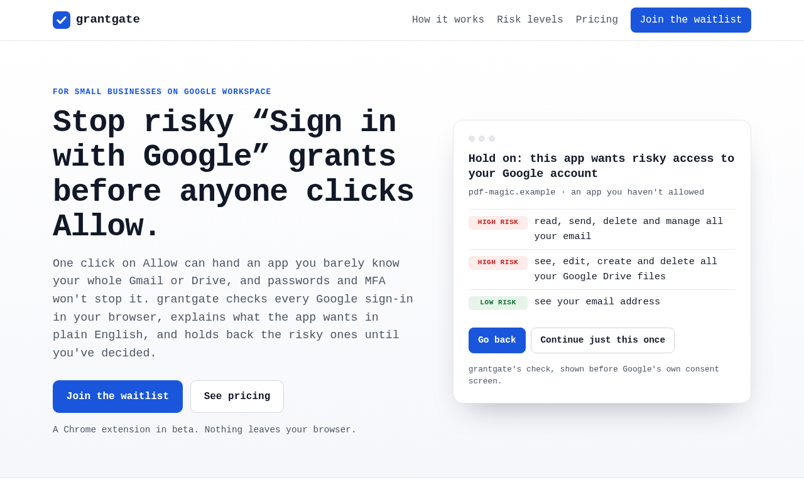
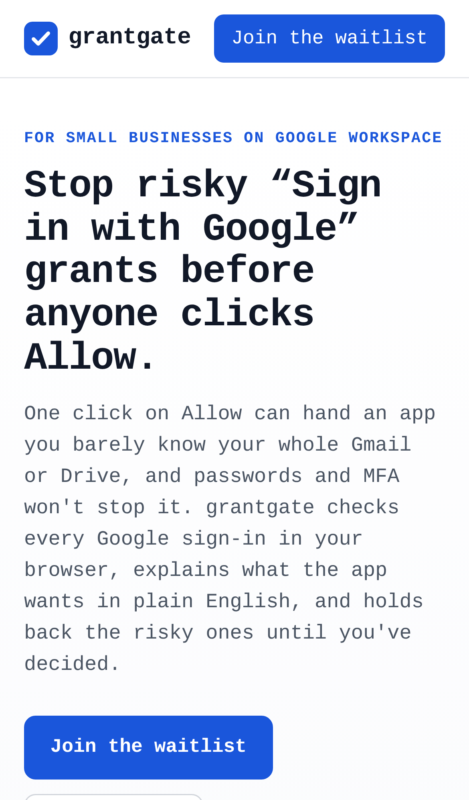
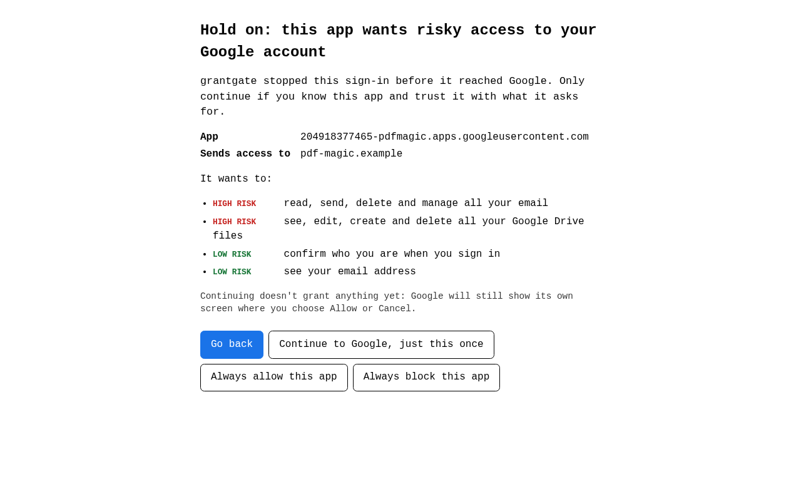
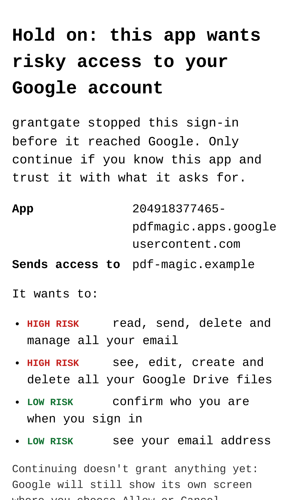
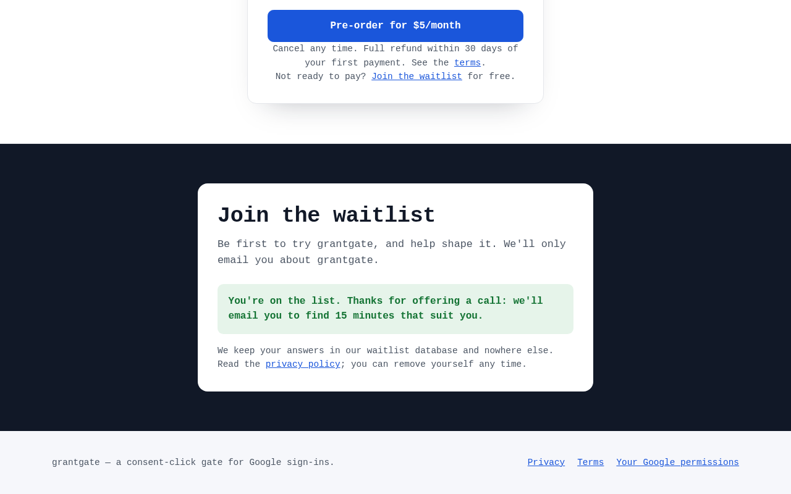
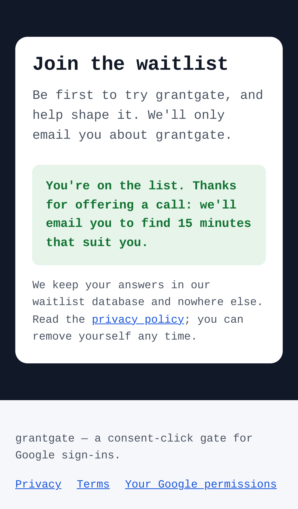

# grantgate — consent-click gate for Google OAuth grants

## Screenshots

The landing page renders from the production build, with the risk preview quoting the product's own labels.

The same page fits an iPhone 13 screen, with the header collapsed to its call to action.

The built extension's page is fed a sample sign-in by the real `assess()`. It rates Gmail and Drive high, sign-in low, and offers the four choices.

The gate's explanation stays readable on a phone, including the long app ID.

A real form submission went through `/api/waitlist` to the store and came back with the "offered a call" reply.

Email capture works on a phone too. These were taken with `npm run screenshots`, using sample data and an in-memory store. The sandbox's Chromium only has a monospace font installed.

For owners of 5–50 person Google Workspace businesses with no IT staff, it intercepts "Sign in with Google" consent prompts, blocks risky scope grants and keeps a local encrypted ledger, for a flat few dollars a month instead of enterprise tools that start at $750/month.

- [Research](RESEARCH.md) — findings and sources
- [PRD](PRD.md)
- [Roadmap](ROADMAP.md)
- [Build notes](BUILD.md): what's built (M1–M4), how to run, test and deploy it
- [Interview script](docs/interview-script.md): the demand test

Effort: Low · Confidence: Low

_Researched by the idea pipeline on 2026-10-11 ([original record](https://github.com/smithdavedesign/idea-factory/tree/main/ideas/grantgate)); repo created on David's go-ahead 2026-10-11._
