# grantgate — consent-click gate for Google OAuth grants

## Live

**https://grantgate.1426davejobs.workers.dev**

The website runs on a Cloudflare Worker (free plan) since 2026-11-08; the Vercel account is blocked, and `grantgate-ashen.vercel.app` answers 402. Screenshots taken against the live Worker by Playwright in Chrome for Testing.

| | Desktop (1440×900) | Phone (390×844) |
|---|---|---|
| The landing page: what grantgate stops, with a preview of its consent gate | 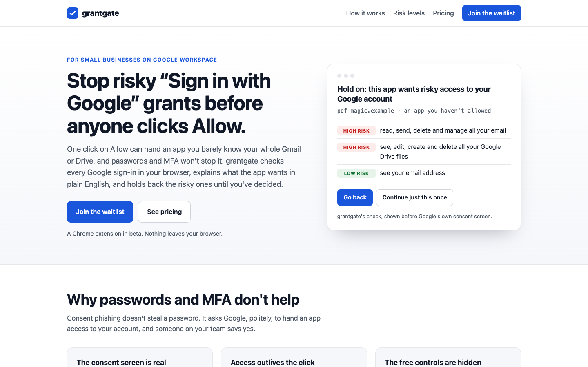 | 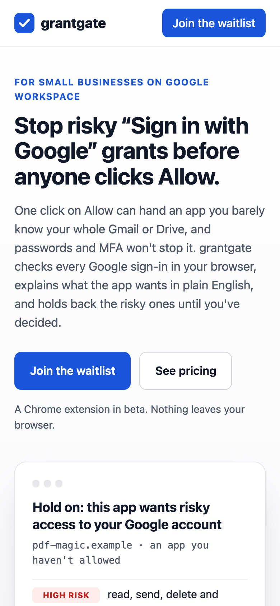 |
| Pricing: $49 a year (checkout isn't open yet: no payment link is stored, so the button joins the waitlist) | 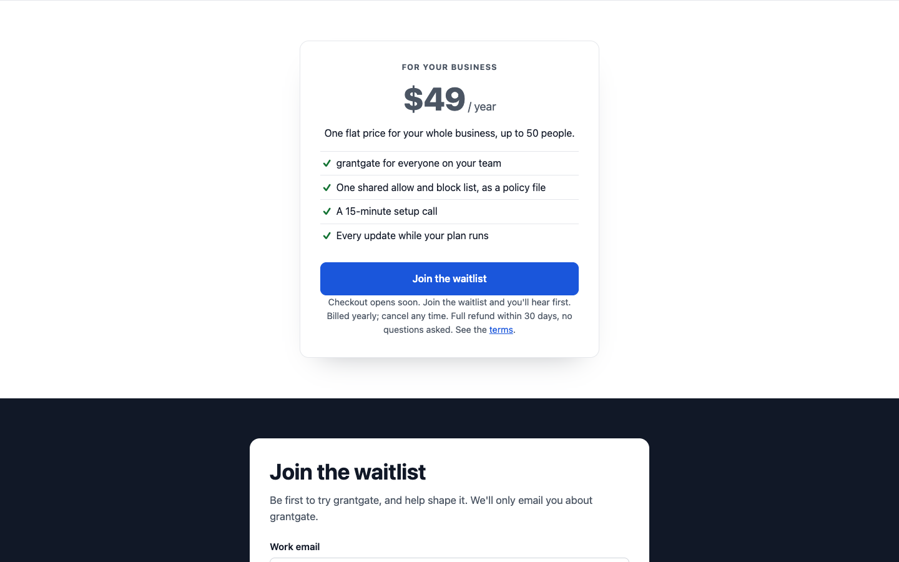 | 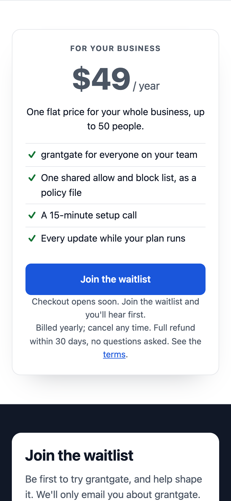 |
| The core action: joining the waitlist, saved in Neon through the Worker's /api/waitlist | 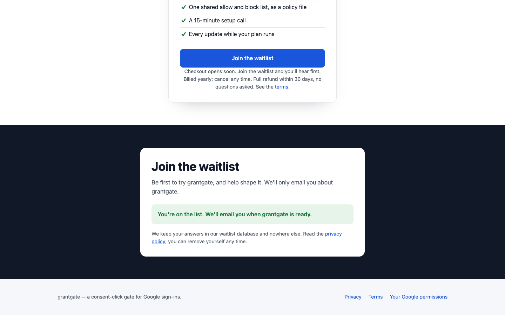 | 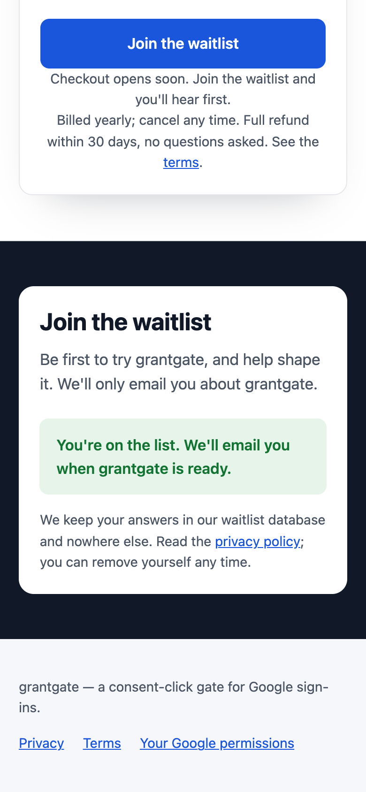 |
| The privacy page: the same address removed again, so the screenshot run left no data | 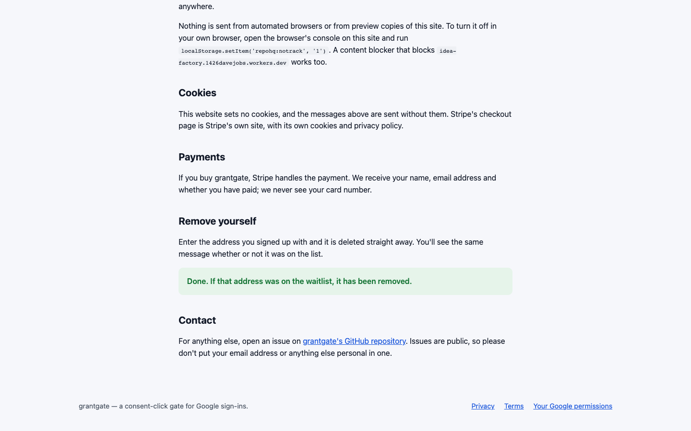 | 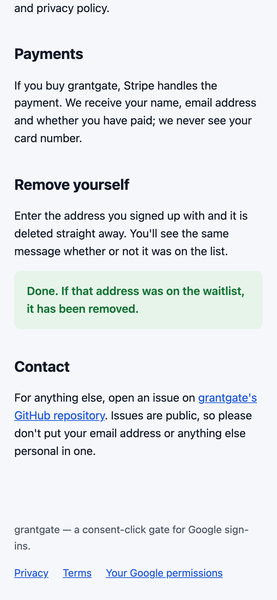 |

## Screenshots

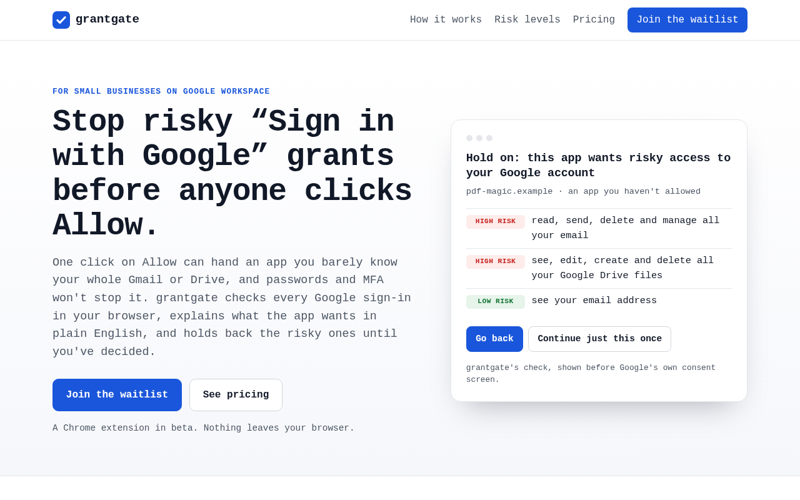
The start page, served from the production build, with a risk preview that quotes the extension's own labels.

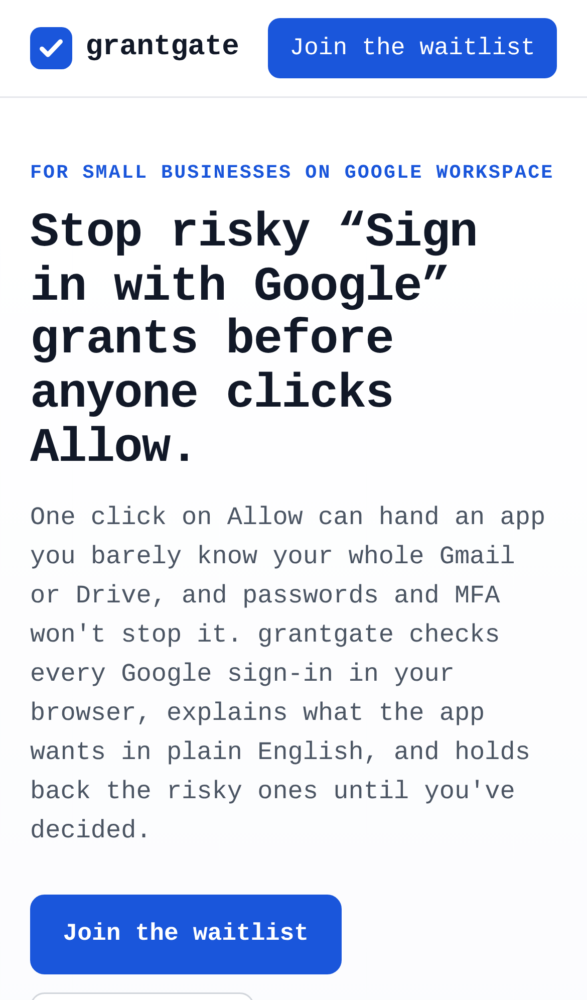
The same start page fits an iPhone 13 screen, with the header collapsed to its call to action.

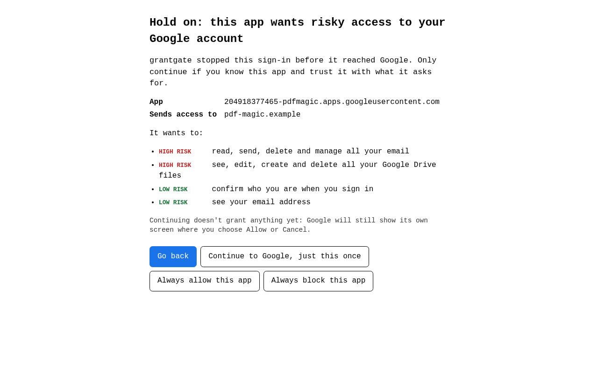
The core action: the built extension's own page, given a sample sign-in by the real `assess()`, holds back Gmail and Drive access and offers its four choices.

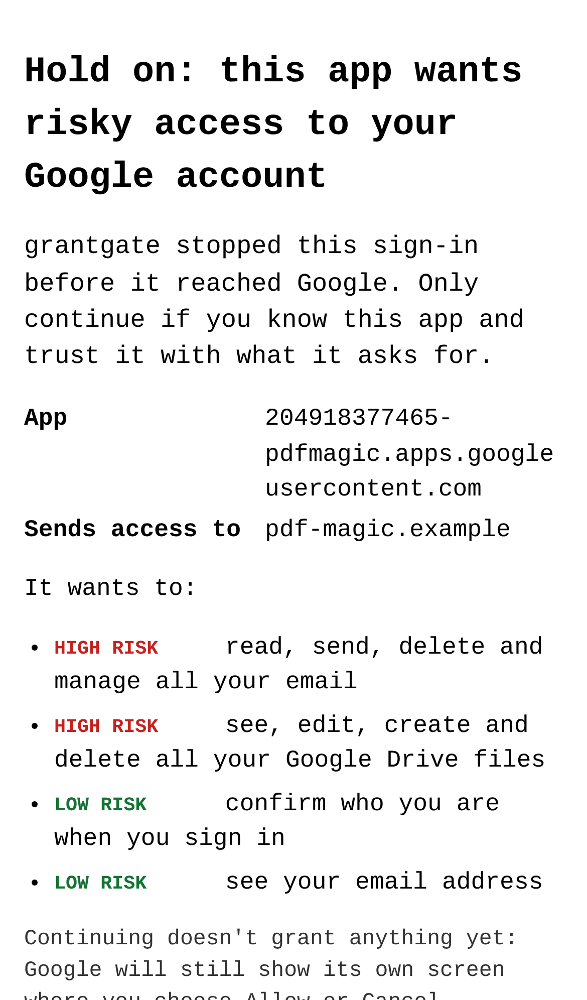
The gate stays readable on a phone, long app ID included.

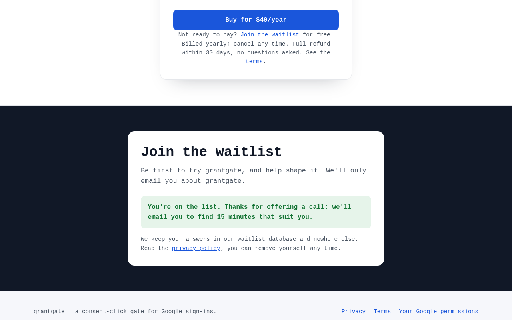
A real sign-up went through `/api/waitlist` and got its reply, with the Buy button (placeholder payment link) and the footer's Privacy and Terms links in view.

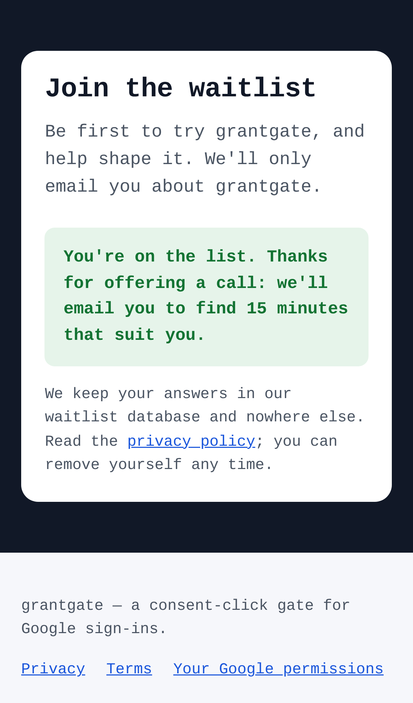
Buying and joining work on a phone too. Taken by `npm run screenshots` with sample data, an in-memory store and a placeholder `STRIPE_PAYMENT_LINK`; the sandbox's Chromium has only a monospace font.

For owners of 5–50 person Google Workspace businesses with no IT staff, it intercepts "Sign in with Google" consent prompts, blocks risky scope grants and keeps a local encrypted ledger, for a flat $49 a year instead of enterprise tools that start at $750/month.

- [Research](RESEARCH.md) — findings and sources
- [PRD](PRD.md)
- [Roadmap](ROADMAP.md)
- [Build notes](BUILD.md): what's built (M1–M4), how to run, test and deploy it
- [Launch notes](LAUNCH-READY.md): search and sharing tags, privacy and terms, the Buy button, the visit beacon, and what's left before launch
- [Interview script](docs/interview-script.md): the demand test

Effort: Low · Confidence: Low

_Researched by the idea pipeline on 2026-10-11 ([original record](https://github.com/smithdavedesign/idea-factory/tree/main/ideas/grantgate)); repo created on David's go-ahead 2026-10-11._

## Hosting on Cloudflare Workers

Since 2026-11-08 the website is the `grantgate` Worker on Cloudflare (free plan, commercial use allowed).
[`wrangler.jsonc`](wrangler.jsonc) serves the static pages from `.cloudflare/assets/` with `html_handling:
auto-trailing-slash` (`/privacy` → `privacy.html`, like the Vercel routes), and `.cloudflare/assets/_headers` gives
them the same CSP and security headers as the Vercel build. Requests under `/api/` reach
[`src/site/worker.ts`](src/site/worker.ts), which runs the same fetch-style `handleApi` as the Vercel functions:
`/api/waitlist` (Neon over HTTPS, from the `DATABASE_URL` secret) and `/api/checkout` (`STRIPE_PAYMENT_LINK`, read at
runtime). Vercel ignores `wrangler.jsonc`, so `npm run build:site` still writes the Vercel deploy.

```bash
npm run cf:build                                       # .cloudflare/assets/, counted as production (NEXT_PUBLIC_DEPLOY_ENV=production)
provision cloudflare deploy grantgate "$PWD"           # wrangler deploy through the credential broker (token from the keychain)
provision cloudflare secret grantgate DATABASE_URL     # the waitlist database, pushed from the keychain
provision cloudflare url grantgate                     # https://grantgate.1426davejobs.workers.dev
```

The build writes its deploy env into `<meta name="deploy-env">`: `NEXT_PUBLIC_DEPLOY_ENV` from `cf:build`, else Vercel's
`VERCEL_ENV`, and the visit beacon only sends on `production`. Canonical and share URLs default to the Worker's address
(`DEFAULT_ORIGIN` in `scripts/site-pages.ts`; `VERCEL_PROJECT_PRODUCTION_URL` at build time still overrides it). No
`STRIPE_PAYMENT_LINK` is stored for grantgate, so the page offers the waitlist and `/api/checkout` answers "checkout
opens soon". Once there is one, `provision stripe grantgate … --host cloudflare` sets it on the Worker, where
`/api/checkout` reads it at once; the landing page's Buy button is drawn at build time, so it also needs the link in
`cf:build`'s environment and a redeploy.
